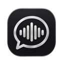

  

<h1 align="center">EchoGram</h1>

Неофициальный клиент Telegram для macOS

## Возможности

- **Музыка.** В отдельной вкладке открываются веб-библиотеки SoundCloud, Spotify и Яндекс Музыки. Войти можно через соответствующий сервис.
- **Ссылки.** Веб-страницы из сообщений можно открывать в боковой панели, оставаясь в чате.
- **Режим стримера.** Выберите «EchoGram → Режим стримера» или нажмите ⇧⌘S, чтобы скрыть окно чатов и отключить уведомления.

## Скачать

Скачайте [EchoGram для Mac с Apple Silicon](https://github.com/sspacee017/EchoGram/releases/latest). Нужна macOS 15 или новее.

Откройте DMG, перетащите EchoGram в «Программы» и запустите его. На телефоне откройте Telegram, выберите «Настройки → Устройства → Подключить устройство» и отсканируйте QR-код. Можно также войти по номеру телефона.

Сборка подписана локальной подписью и пока не нотарифицирована Apple.

## Сборка из исходников

Требования к Xcode, команды сборки и подготовка релиза описаны в [BUILDING.md](BUILDING.md).

## Исходники и лицензия

EchoGram основан на [Telegram для macOS](https://github.com/TelegramMessenger/telegram-macos) и использует Telegram API. Исходный код распространяется по [GNU GPL v2](LICENSE). Изменённые файлы перечислены в [CHANGES.md](CHANGES.md).
